# ☁️ Stratus

**A working CRM for your Mac that works the way Salesforce does, with AI in every app.**

Stratus runs a whole demo company on your Mac: Sales, Service, Marketing, Commerce, Agentforce, Data Cloud, Tableau, Slack, MuleSoft and Field Service, all sharing one set of records. You can create, edit and delete records, drag deals across a Kanban board, build reports and dashboards, run flows, and reply to cases. ✨ AI is built into every app, and you choose which AI it uses: Claude, ChatGPT, Gemini, a local model or any OpenAI-compatible server.

Everything runs locally on a made-up company, **Brightwave Energy** (solar, batteries, EV chargers and smart-home gear). There's no server and no sign-up, and nothing leaves your Mac except the AI calls you choose to make.

> Stratus is an independent learning project. It is **not affiliated with, endorsed by or connected to Salesforce, Inc.** Product names describe what each page does in the way Salesforce's products do. All companies, people and data are fictional.

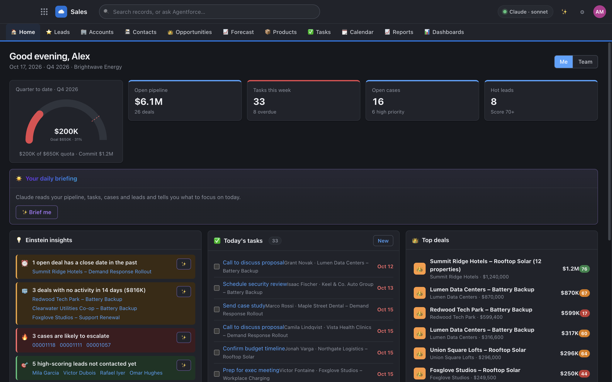

## What's inside

| App | What you can do | ✨ AI |
|---|---|---|
| **Sales** ☁️ | Leads, accounts, contacts, opportunities, products, tasks. List views, Kanban pipeline, record pages with path, related lists, activity timeline and Chatter. Lead convert, quotes, forecasts with manager adjustments, and a week/month calendar. | Lead brief, deal coach, win score with reasons, email drafts, forecast call, meeting prep, plan my week, "filter this list in plain words" |
| **Service** 🎧 | Service console with a case queue, thread, reply/email/internal note, Knowledge articles, entitlements and SLAs. | Draft reply grounded in Knowledge, case summary, priority/type suggestions, article drafted from a solved case |
| **Marketing** 📣 | Campaigns, journey canvas, email studio and segments. | Build a journey from a sentence, write an email from a brief, subject lines, tone rewrite, campaign brief |
| **Commerce** 🛍️ | A working storefront with cart and checkout that creates real Orders, plus a catalog and commerce insights. | Shopping assistant chat, "describe what you need" search, product descriptions, merchandising ideas |
| **Agentforce** 🤖 | A chat agent that reads **and acts on** your data (log a call, create a task, update a record), with undo. Agent Builder, Prompt Builder and an Agent Log. | Everything. Agents run on the AI you picked |
| **Data Cloud** 🧬 | Unified profiles, data streams, identity resolution (merge duplicates, with undo), calculated insights and segments. | Profile summaries, next best offer, match explanations, stream mapping, segment from words |
| **Tableau** 📊 | Ask Data, Pulse metrics and workbooks. | Ask a question in your own words to get a chart, then pin it to a dashboard. Pulse digest, metric and chart explanations |
| **Slack** 💬 | Channels, DMs and threads tied to records. `/case` opens a case and `@Agentforce` answers in-channel. | Catch me up, thread summaries, draft reply |
| **MuleSoft** 🔗 | Integrations (source → transform → filter → target) that really run against your records, an API catalog with a live console (200 / 401 without `client_id`), and run history. | Fix a failing integration, build a mapping from words, write an API spec |
| **Field Service** 🔧 | Dispatch board, work orders, technicians and a map. Auto-schedule with review → apply → undo. | Optimize the schedule, plan routes, work order briefing for the technician |

Across every app:

- **Reports and dashboards:** tabular, summary and chart reports, dashboards from report widgets, and "✨ build it from a sentence".
- **Setup:** Object Manager (custom objects, fields, formulas), Flow Builder with run history, users, the Einstein Trust Layer (masking and audit), an AI Audit Trail, a Recycle Bin, and data import/export.
- **Global search** across every object, the App Launcher, **log in as another user**, and a reset for the demo org.
- **Appearance:** System, Light or Dark (default System). There's also a ☁️ menu-bar icon.

## Choose your AI

Open **Settings → AI** and pick a provider. Stratus uses its name throughout ("✨ Claude…", "✨ ChatGPT…").

| Provider | Needs |
|---|---|
| **Claude Code** (default when installed) | The `claude` command on this Mac. No key needed |
| **Anthropic · Claude API** | An API key |
| **OpenAI · ChatGPT** | An API key |
| **Google Gemini** | An API key |
| **OpenRouter** | One key for many models |
| **Ollama** | Ollama running on this Mac. Free and offline |
| **OpenAI-compatible** | Any server that speaks the OpenAI API (LM Studio, Groq, Mistral…) |

- API keys are encrypted with macOS Keychain (Electron `safeStorage`) and never stored in plain text.
- The **Trust Layer** masks emails and phone numbers before a prompt leaves the app, and logs every call in the AI Audit Trail.
- AI never changes data on its own. It drafts, and you click to apply.
- With AI off, everything else still works: scores, insights and charts are rule-based.

## Screenshots

| | |
|---|---|
| 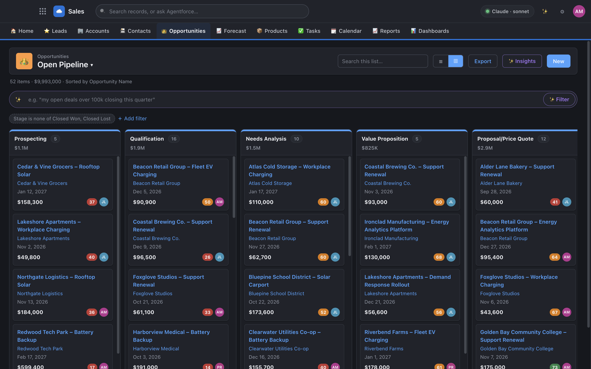 Pipeline Kanban | 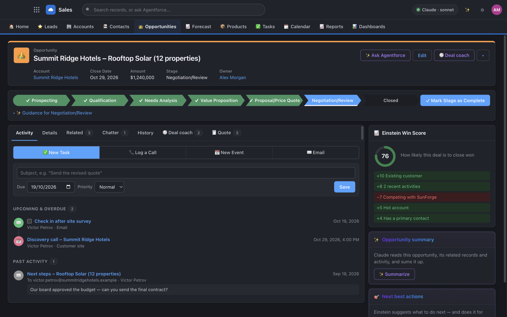 Opportunity record |
| 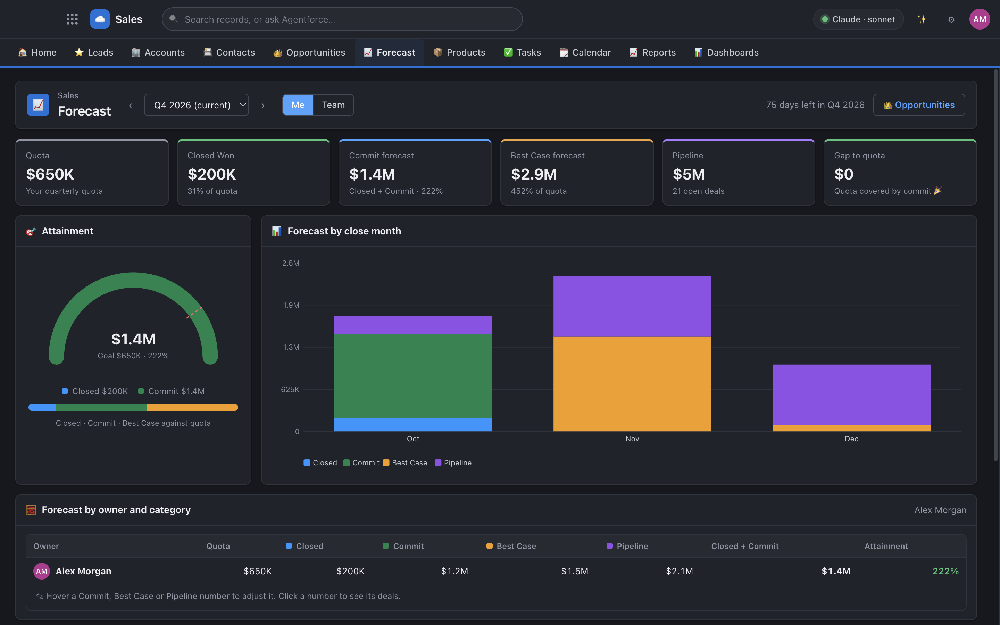 Forecast | 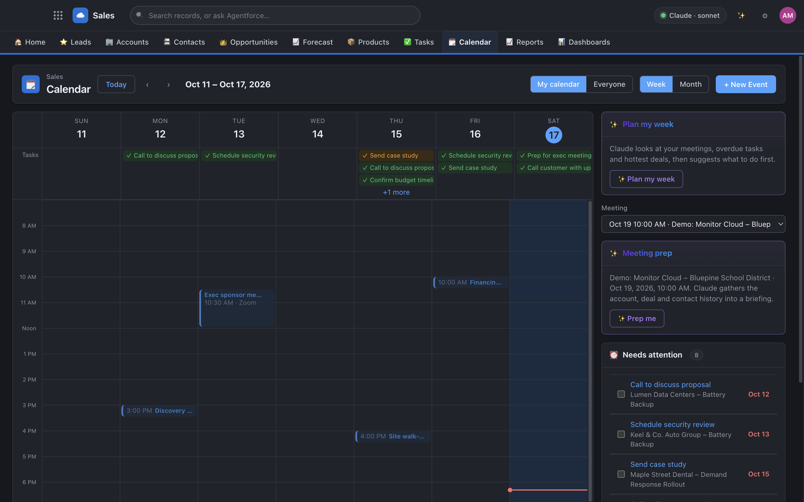 Calendar |
| 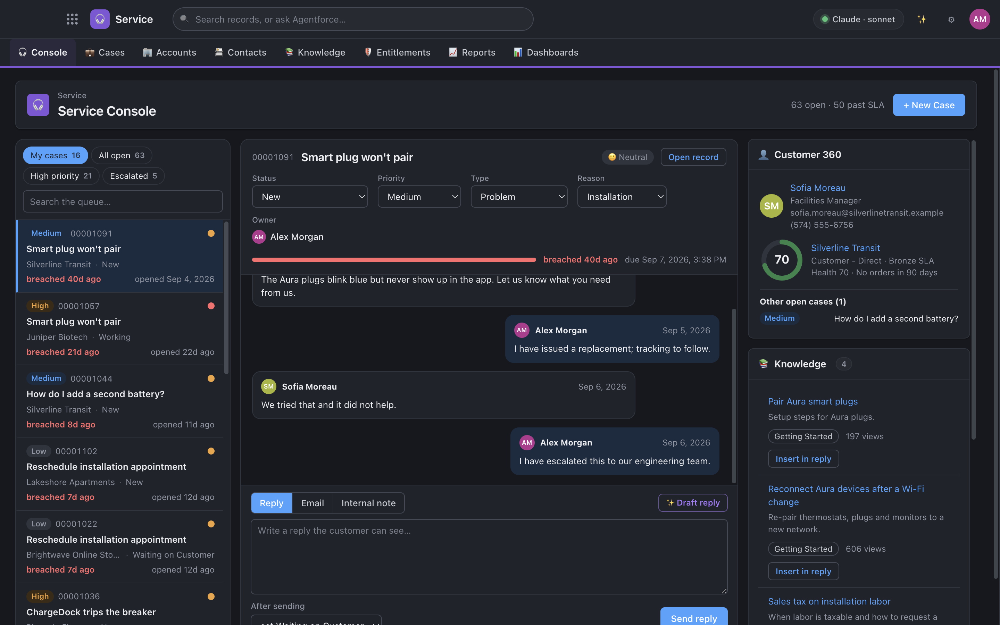 Service console | 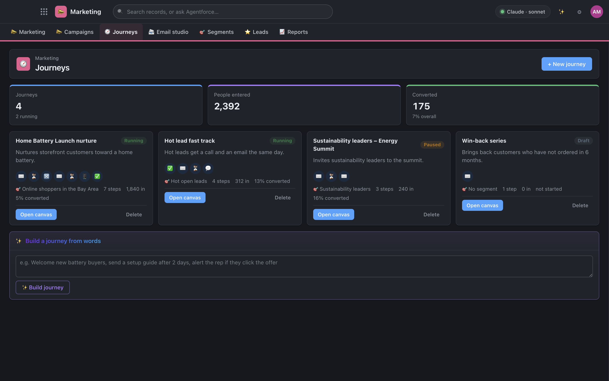 Marketing journeys |
| 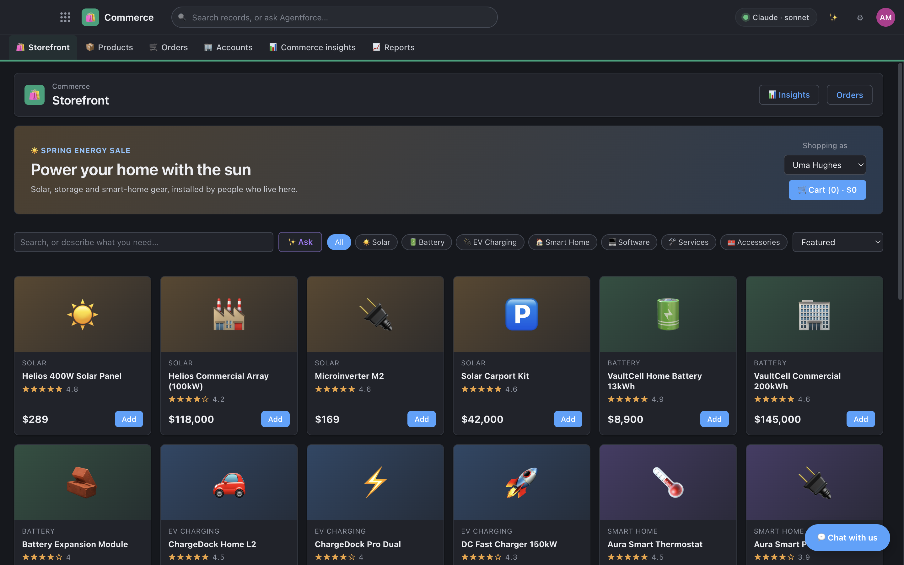 Commerce storefront | 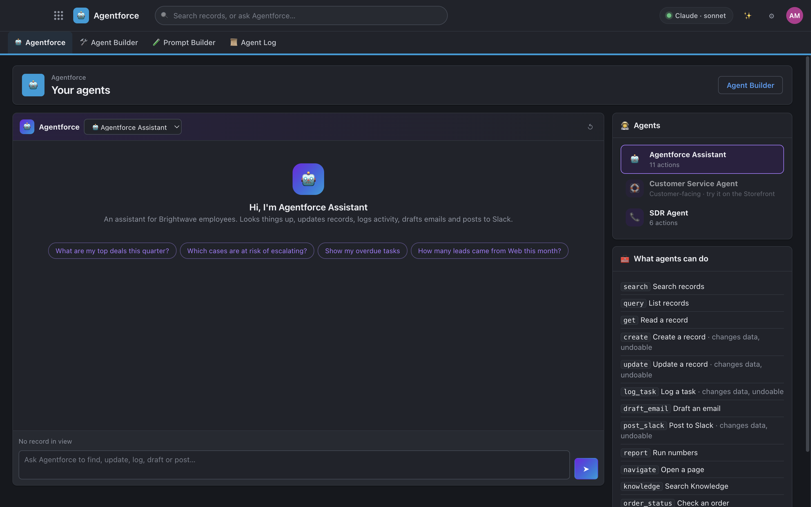 Agentforce |
| 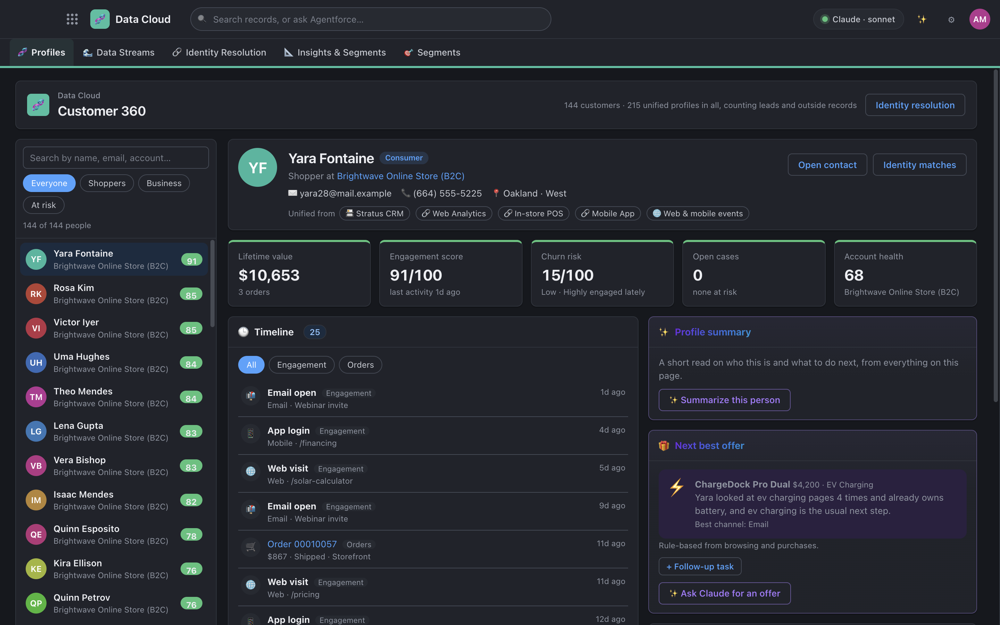 Data Cloud profiles | 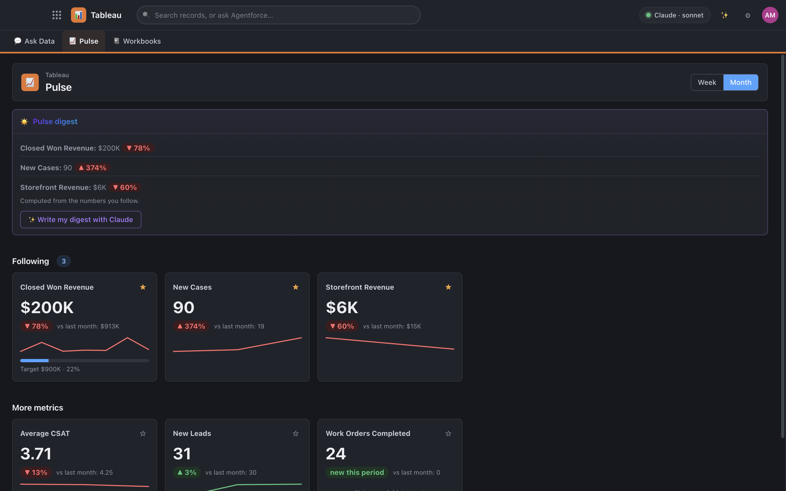 Tableau Pulse |
| 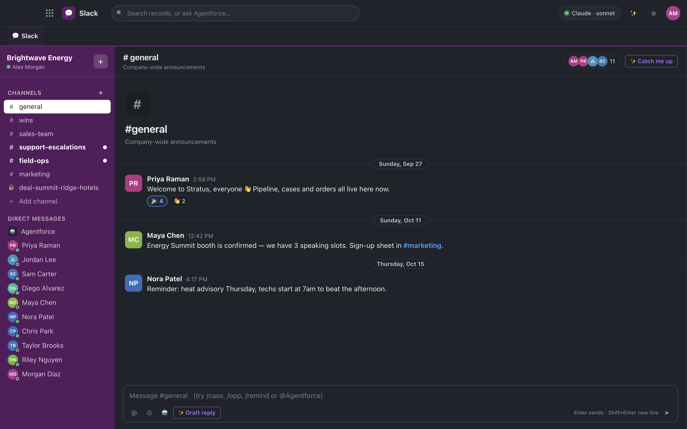 Slack | 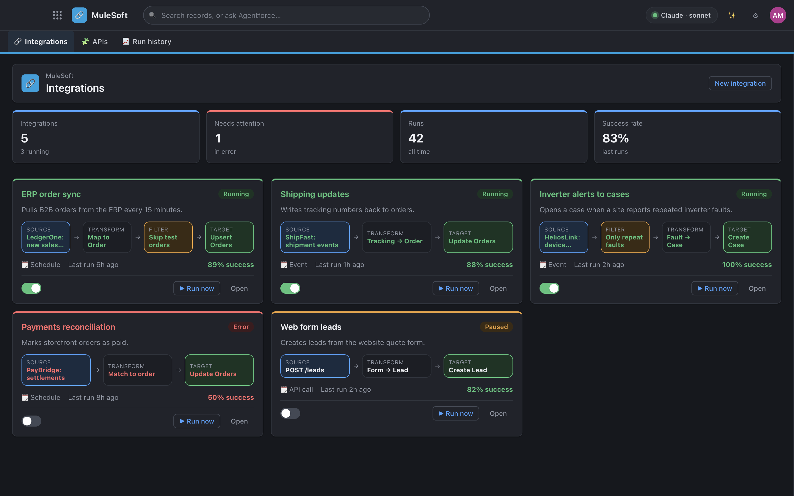 MuleSoft integrations |
| 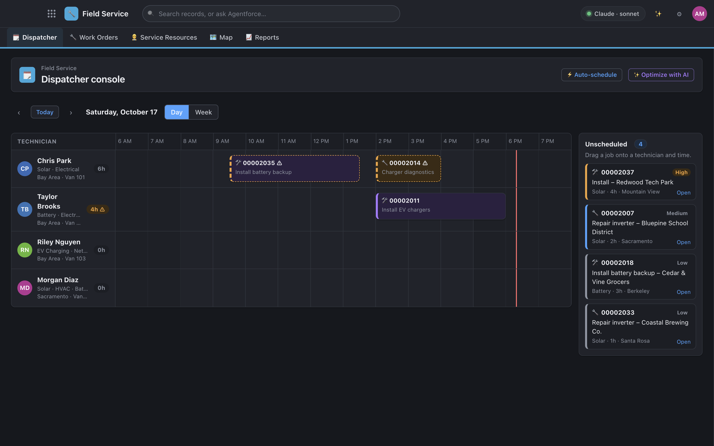 Field Service dispatch | 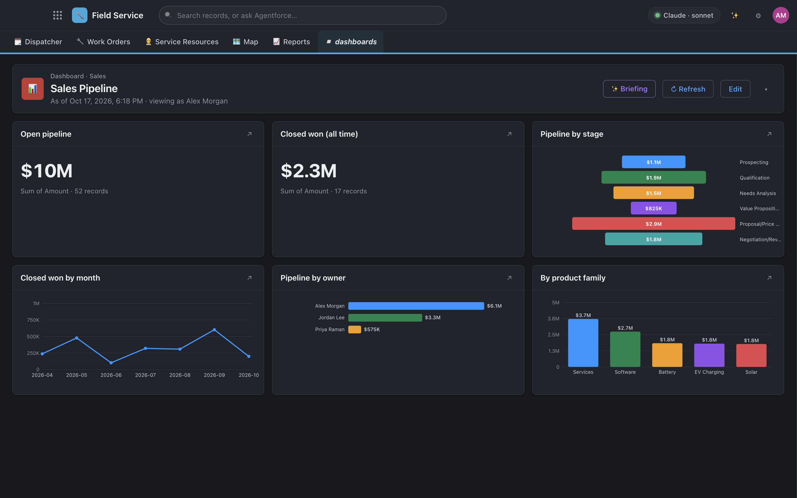 Dashboard |
| 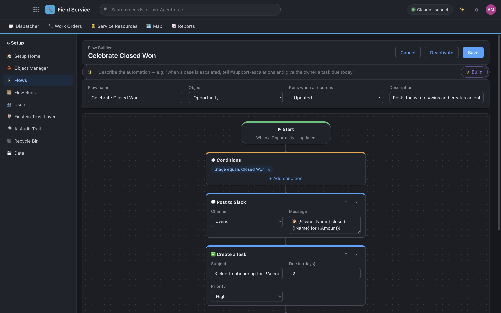 Flow Builder | 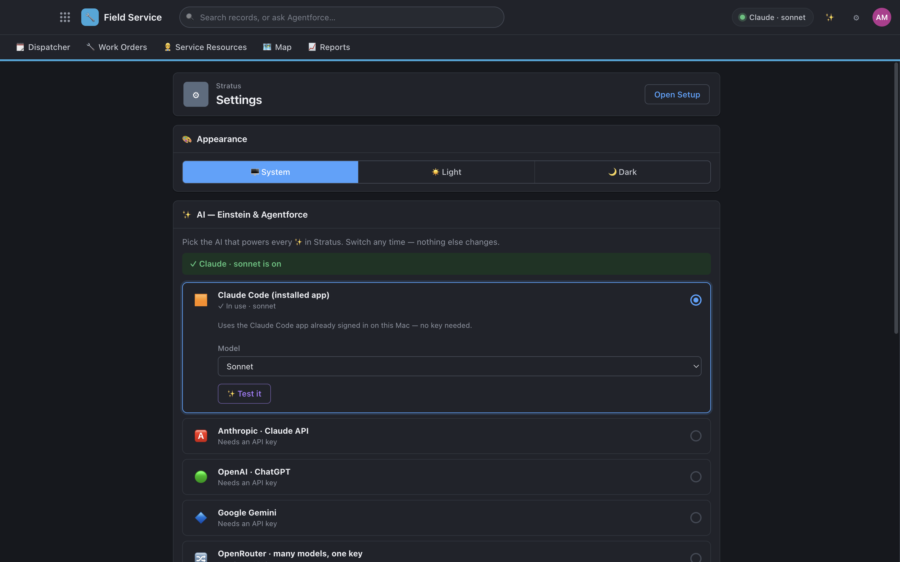 Settings and AI picker |

## Install

Download **Stratus-1.0.1.dmg** from [Releases](https://github.com/Sravankumartangudu/stratus/releases), open it and drag Stratus to Applications. It's a universal app for Apple silicon and Intel.

The app isn't notarized. The first time you open it, right-click Stratus → **Open**. If macOS still refuses, run:

```sh
xattr -dr com.apple.quarantine /Applications/Stratus.app
```

Your demo org is saved in `~/Library/Application Support/stratus/org.json`. To start over, use the avatar menu → **Reset demo org…**.

## Build from source

```sh
git clone https://github.com/Sravankumartangudu/stratus.git
cd stratus
npm install
npm start            # run it
npm run fresh        # run it on a brand-new demo org
npm run dist         # build Stratus.app and copy it to /Applications
npm run package      # build the universal DMG
```

There's no framework and no build step: the renderer is plain JavaScript. [docs/ARCHITECTURE.md](docs/ARCHITECTURE.md) covers how it fits together and how to add a page.

## Tests

| Command | What it checks |
|---|---|
| `npm test` | Opens every route (115) on fresh data and fails on any console error or broken page |
| `npm run clicks` | Clicks through real tasks: create/edit/delete, Kanban drag, forecast adjust, calendar, merge + undo, segments, Slack `/case`, integrations, API console, dispatch, checkout, appearance |
| `npm run clicks -- --ai` | Adds the typed-in AI steps (draft replies, filter, build report/dashboard, Agentforce actions, Ask Data, store chat, optimize) against your real AI |
| `npm run ai-sweep` | Presses **every** ✨ button on every page and record with your real AI and reports any failure (`--shard 1/4` splits the work) |
| `npm run shot` | Regenerates the screenshots above |

## License

[MIT](LICENSE) © 2026 Sravankumartangudu
